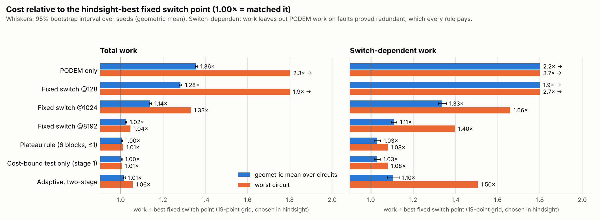
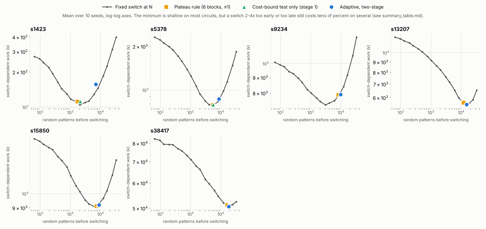
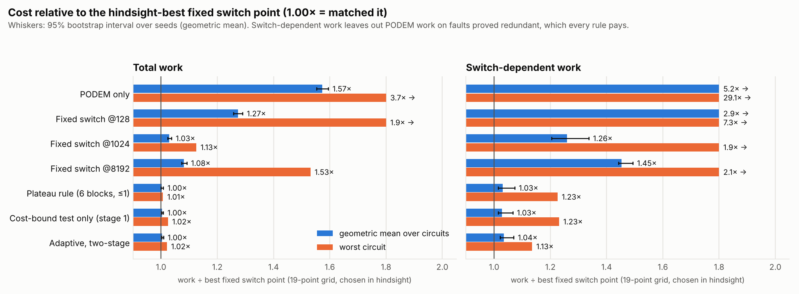
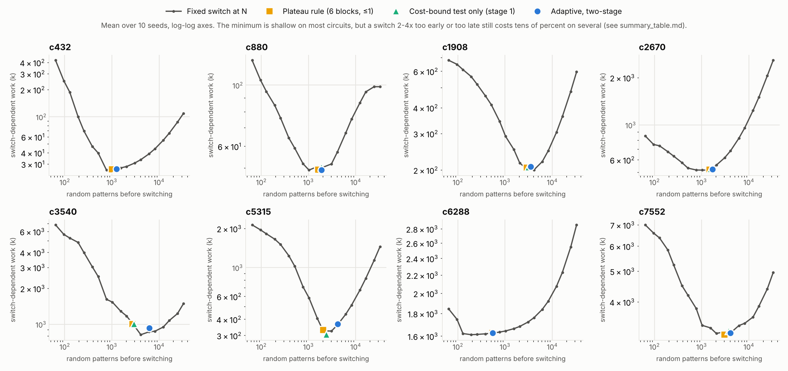
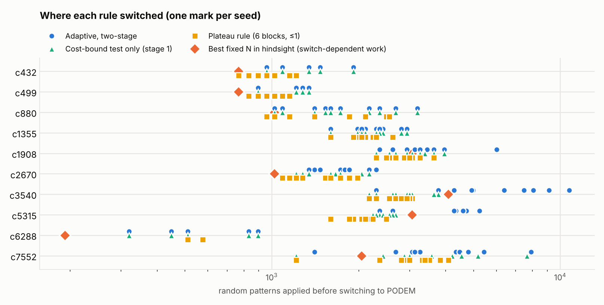

# Adaptive Fault-Coverage-Driven Test Generation for Combinational Circuits

**Bridging Random Testing and Deterministic ATPG**

Course project — Testing of VLSI Circuits (BEVD309L), VIT Vellore
Vidit Narayan Panigrahi (24BVD0167) · Varun V Nair (24BVD0061)

Random patterns detect most stuck-at faults almost for free, then stall on a
residue of random-pattern-resistant faults. Deterministic ATPG (PODEM) can target
that residue but costs much more per fault. Hybrid flows run random patterns
first and hand the rest to ATPG. *When* to switch is usually a fixed pattern
count chosen in advance, and the best count differs from circuit to circuit.

This project decides the switch point **online**, from the circuit's own coverage
trajectory, and measures how much the decision rule matters, first on ISCAS-85
(where the settings were chosen) and then on six held-out ISCAS-89 circuits.

## Findings

**In one paragraph.** A simple online rule (switch when 6 blocks of 64 random
patterns find at most 1 new fault) lands within about 3% of the best fixed
switch point chosen in hindsight, on ISCAS-85 and on held-out ISCAS-89 circuits
alike, with every fault resolved. A fixed pattern count that is good on one
benchmark set is poor on the other. Our two-stage rule, which probes PODEM's
yield before switching, ties on ISCAS-85 but is measurably worse on ISCAS-89
because it switches late, so we do not recommend it over the plain plateau rule.

### ISCAS-85 (settings chosen here)

All 11 ISCAS-85 circuits, 10 seeds each. Every flow uses the same collapsed fault
list, fault simulator, PODEM engine and SAT fallback, so differences come only
from when the switch happens. Each rule is compared with an **oracle**: the best
of 19 fixed switch points (64 to 32,768 patterns), chosen per circuit in
hindsight. Intervals are 95% bootstrap intervals over seeds.

1. **Every flow reaches complete fault efficiency.** Faults PODEM aborts on are
   resolved exactly by a SAT-based fallback: either a test or a proof of
   redundancy. All flows except pure random end with **FE = 100% and identical
   detected counts on every circuit and seed**; the sweep fails if they differ.
   The proved-redundant counts are 4 / 8 / 0 / 8 / 9 / 117 / 137 / 59 / 34 / 131
   for c432 … c7552. Without the fallback, 1 detectable fault was left
   undetected in some runs on c3540 and c7552, and 53–79 redundant faults on
   c2670, c3540 and c7552 stayed unproven.
2. **Switching at the right point matters a lot; how the right point is found
   hardly matters.** A fixed switch costs 1.03–1.27× the oracle on total work
   even for the best common choice, and PODEM alone costs 1.57× (3.7× on c880).
   Three online rules all land within 0.5% of the oracle, and are statistically
   indistinguishable from each other:

   | method | total work ÷ oracle | 95% interval | switch-dependent work ÷ oracle | 95% interval |
   |---|---:|---:|---:|---:|
   | PODEM only | 1.573 | 1.553–1.595 | 5.160 | 5.045–5.378 |
   | fixed switch @128 | 1.273 | 1.258–1.290 | 2.919 | 2.833–3.056 |
   | fixed switch @1024 | 1.029 | 1.024–1.037 | 1.259 | 1.204–1.337 |
   | fixed switch @8192 | 1.082 | 1.074–1.092 | 1.453 | 1.442–1.493 |
   | plateau rule (6 blocks, ≤1 fault) | 1.002 | 1.000–1.008 | 1.031 | 1.015–1.073 |
   | cost-bound test (stage 1) | 1.004 | 1.002–1.008 | 1.028 | 1.014–1.066 |
   | adaptive, two-stage | 1.004 | 1.002–1.009 | 1.035 | 1.021–1.070 |

   Geometric means over the 10 circuits. Pairwise differences between the three
   rules have intervals that include 1 on both measures (for example plateau ÷
   adaptive: 0.998, 0.994–1.004 on total work; 0.994, 0.968–1.029 on
   switch-dependent work). Against the best common fixed choice (@1024) they use
   2.5% less total work and about 18% less switch-dependent work (intervals
   0.967–0.982 and 0.775–0.871).
3. **The second stage (the Review-I proposal) adds nothing on ISCAS-85**, and on
   ISCAS-89 it costs more (next section). The two-stage method
   measures PODEM's actual yield with a probe before switching. The cost-bound
   test alone, which skips the probe, does as well, and the plateau heuristic
   (switch when 6 blocks of 64 patterns find at most 1 new fault) does as well
   again. The plateau rule is the first stage with a sliding window: at α = 0.05
   and window μ = 6 the Poisson test rejects exactly when a window saw k ≤ 1
   faults. The statistics explain why that threshold is reasonable; they do not
   beat it. The second stage is also the most sensitive to its own settings
   (see below).
4. **Switching early is far more expensive than switching late.** Using the fixed-N
   curve, a switch at N/2 of the best point costs 1.03–1.83× the optimum in
   switch-dependent work (above 1.4× on c432, c1355, c3540), at N/4 up to 3.9×;
   a switch at 2N costs 1.00–1.35× and at 4N up to 2.07×. The curve is shallow
   only on the late side. All three rules switch at 0.7–2.9× the best N, which is
   the safe side.
5. **Test-set size does not depend on the switch rule.** After reverse-order
   compaction, every hybrid rule lands at 0.97× the PODEM-only test count
   (geometric mean over circuits, 0.969–0.974 across rules).
6. **Pure random** (up to 32,768 patterns) reaches the same detected count as
   the hybrids on 7 of 10 circuits in every seed, within one fault on c3540, and
   falls short on c2670 (2342 vs 2630) and c7552 (7190 vs 7419). It proves
   nothing redundant, so on total work it is cheaper than every hybrid on 7
   circuits (0.05–0.87× the oracle) and dearer on c880 (2.0×); on
   switch-dependent work it is never cheaper (1.1–6.0×). If redundancy proofs are
   not needed, long random runs are a reasonable choice on most of these circuits.

### ISCAS-89, held out (full scan)

Six ISCAS-89 circuits, run after every setting was fixed: s1423, s5378, s9234,
s13207, s15850, s38417 (1,515 to 31,180 collapsed faults; flip-flops read as
full scan). Same 19-point grid, 10 seeds, same code and defaults. Results are in
`results_iscas89/`; reproduce with `make sweep89`.

1. **Every fault is resolved again.** FE = 100% on every circuit, seed and
   method except pure random. Proved-redundant counts: 14 / 40 / 452 / 151 / 389 / 165.
   On s9234, PODEM aborts on 210 faults and the SAT fallback proves all 210
   redundant; on s38417 it turns about 55 aborts per run into about 3 tests and 52 proofs.
2. **The plateau rule and the stage-1 test transfer unchanged.**

   | method | total work ÷ oracle | 95% interval | switch-dependent work ÷ oracle | 95% interval |
   |---|---:|---:|---:|---:|
   | PODEM only | 1.356 | 1.352–1.360 | 2.193 | 2.171–2.219 |
   | fixed switch @128 | 1.282 | 1.278–1.288 | 1.869 | 1.838–1.902 |
   | fixed switch @1024 | 1.139 | 1.136–1.143 | 1.335 | 1.318–1.355 |
   | fixed switch @8192 | 1.023 | 1.020–1.026 | 1.108 | 1.095–1.122 |
   | plateau rule (6 blocks, ≤1 fault) | 1.003 | 1.001–1.007 | 1.029 | 1.018–1.044 |
   | cost-bound test (stage 1) | 1.002 | 1.000–1.005 | 1.028 | 1.017–1.043 |
   | adaptive, two-stage | 1.015 | 1.011–1.019 | 1.104 | 1.076–1.133 |

   Geometric means over the 6 circuits. Plateau and stage 1 are
   indistinguishable (plateau ÷ stage 1: 1.001, 0.992–1.009 on switch-dependent
   work), and match their ISCAS-85 numbers.
3. **The two-stage rule is worse here.** Plateau ÷ two-stage is 0.933
   (0.906–0.960) on switch-dependent work and 0.989 (0.984–0.993) on total work:
   the difference is small but its interval excludes 1. The probe makes the rule
   keep random patterns running after they have stalled. On s1423 the best N is
   2,048 and two-stage switches at 6,931 on average (1.50× the oracle, 2.3× on the
   worst seed); on s5378, 8,691 against 4,096 (1.10×). Plateau switches at
   0.7–2.7× the best N on these circuits.
4. **A fixed count does not transfer; online rules do.** The best N is 2,048 to
   16,384 here (192 to 4,096 on ISCAS-85). Fixed @1024, nearly as good as the rules
   on ISCAS-85 (1.029× total), costs 1.139× total and 1.335× switch-dependent on
   ISCAS-89. Fixed @8192 goes the other way (1.082× on ISCAS-85, 1.023× here). No
   single N is good on both sets; the online rules are.
5. **Early switching still costs more than late, but less sharply.** N/4 costs up
   to 1.58× and 4N up to 1.44× in switch-dependent work.

Across all 16 circuits together, switch-dependent work ÷ oracle is 1.030
(1.019–1.056) for plateau, 1.028 (1.019–1.053) for stage 1 and 1.060
(1.048–1.086) for two-stage.





### ISCAS-85 plots







**Two work measures.** *Total work* is all PODEM and fault-simulation work, in
gate evaluations. On 9 of the 11 circuits (all but c17 and c880, which have no redundant faults),
51–98% of it is PODEM work on faults that end up proved redundant, including
aborted ones the SAT fallback then proves. Every flow pays this wherever it switches.
*Switch-dependent work* subtracts PODEM work on faults that end the run
**proved redundant** (by PODEM, or by the SAT fallback after PODEM aborted).
That set is a property of the circuit, identical for every flow. An earlier
version of this metric subtracted work on every undetected fault, which let flows
that abort a detectable fault shave their own score; that bias is gone. The SAT
fallback's own cost (at most 0.7 M propagation steps per circuit) is reported
separately because it is a different unit.

"Worst single seed" in `results/summary_table.md` compares each seed with the
best of the 19 fixed points *for that seed*, an oracle that is optimistic by
construction. Read it as spread, not regret.

Full per-circuit tables (detected, redundant, FE, compacted tests, switch point,
PODEM calls, work, ± stdev over seeds): [`results/summary_table.md`](results/summary_table.md).
Raw data: `results/summary.csv`, `results/curves/`, decision logs in
`results/decisions/`, adaptive test sets in `results/tests/`.

### Sensitivity to each rule's own settings

All circuits × 10 seeds per variant, total-work geomean / worst circuit (from the
sensitivity table in `results/summary_table.md`):

| rule | default | range over the variants tried |
|---|---|---|
| plateau | 6/1: 1.002 / 1.007 | 4/0, 8/1, 8/2, 12/2, 12/3: 1.002–1.005 / 1.017–1.039 |
| stage 1 | α 0.05, μ 6: 1.004 / 1.024 | α 0.01, 0.2; μ 3, 12: 1.003–1.005 / 1.010–1.028 |
| adaptive | α 0.05, confirm 2, probe 16, μ 6: 1.004 / 1.021 | α, confirm, probe, μ, warm-up: 1.002–1.010 / 1.008–1.068 |

On total work every variant is within about 1% geomean (worst 1.010). On switch-dependent work the
adaptive rule varies most (geomean 1.018–1.082, worst circuit up to 1.43 with a
window of 12), the plateau rule least (1.012–1.036). The defaults were chosen
while looking at these circuits. A held-out check ranks each rule's variants on
half the circuits and scores the winner on the other half: the winner beats the
default by at most 0.002 and sometimes loses, so there is no sign that tuning on
this benchmark would transfer, and none of the rules is sensitive enough to
matter on total work.

### Robustness to the cost of PODEM

Every full sweep was repeated with PODEM work multiplied by w (5 seeds, each
weight with its own fixed-N oracle). Entries are geomean / worst circuit.

| w | metric | PODEM only | fixed @1024 | plateau | stage 1 | adaptive |
|---|---|---:|---:|---:|---:|---:|
| 0.25 | total | 1.452 / 2.65 | 1.026 / 1.10 | 1.010 / 1.05 | 1.018 / 1.10 | 1.022 / 1.09 |
| 0.25 | switch-dep. | 2.673 / 8.11 | 1.105 / 1.34 | 1.033 / 1.14 | 1.053 / 1.16 | 1.071 / 1.18 |
| 1 | total | 1.573 / 3.66 | 1.029 / 1.13 | 1.002 / 1.01 | 1.004 / 1.02 | 1.004 / 1.02 |
| 1 | switch-dep. | 5.160 / 29.13 | 1.259 / 1.88 | 1.031 / 1.23 | 1.028 / 1.23 | 1.035 / 1.13 |
| 4 | total | 1.763 / 8.87 | 1.069 / 1.28 | 1.022 / 1.19 | 1.022 / 1.19 | 1.018 / 1.14 |
| 4 | switch-dep. | 12.483 / 101.35 | 1.883 / 6.73 | 1.104 / 1.48 | 1.110 / 1.48 | 1.079 / 1.49 |
| 16 | total | 1.982 / 25.00 | 1.150 / 2.53 | 1.088 / 2.14 | 1.085 / 2.09 | 1.075 / 1.93 |
| 16 | switch-dep. | 33.084 / 388.57 | 3.207 / 22.58 | 1.428 / 2.64 | 1.410 / 2.62 | 1.330 / 2.73 |

The adaptive rules stay ahead of every fixed switch at every weight. Their gap to
the oracle grows with w (more expensive PODEM makes a late switch costlier), and
the ordering among the three rules changes: plateau is slightly best at w ≤ 1,
adaptive slightly best at w ≥ 4. These differences are small next to the seed
noise at 5 seeds, so we do not claim any of the three wins.

### A smaller PODEM budget, now that SAT resolves every abort

Same sweeps with the PODEM backtrack limit lowered (5 seeds; 1024 is the
default, 10 seeds). Total work, geomean / worst circuit, against each setting's own oracle.

| backtrack limit | PODEM only | fixed @1024 | plateau | stage 1 | adaptive | adaptive: aborts → SAT | adaptive: total work (M) | SAT propagations (M) |
|---|---:|---:|---:|---:|---:|---:|---:|---:|
| 32 | 2.733 / 5.92 | 1.061 / 1.30 | 1.007 / 1.02 | 1.014 / 1.05 | 1.026 / 1.11 | 297 | 10.5 | 2.76 |
| 128 | 2.066 / 4.07 | 1.056 / 1.25 | 1.004 / 1.01 | 1.010 / 1.05 | 1.018 / 1.07 | 263 | 20.7 | 2.40 |
| 1024 | 1.573 / 3.66 | 1.029 / 1.13 | 1.002 / 1.01 | 1.004 / 1.02 | 1.004 / 1.02 | 215 | 76.5 | 1.99 |

Since every abort is resolved by SAT, the backtrack limit only trades PODEM work
for SAT work, and coverage is unchanged (FE 100% at every limit). A low limit cuts
gate-evaluation work by 7× (76.5 M → 10.5 M) but sends more faults to SAT; the
SAT propagation counts are in a different unit and are not included in that
total. The rule ranking is unchanged.

## How it works

### Fault model — `src/faults.cpp`
Single stuck-at faults on every **stem and fanout branch** (a signal feeding more
than one gate input or output gets a separate line per destination), stuck-at-0
and stuck-at-1 on each, then structural **equivalence collapsing** (AND input SA0 ≡
output SA0, NAND input SA0 ≡ output SA1, and so on). Collapsed fault counts match the
standard ISCAS-85 numbers for all 11 circuits (c17 = 22, c432 = 524, c880 = 942,
c6288 = 7744, c7552 = 7550).

### Fault simulation — `src/fault_sim.cpp`
Parallel-pattern single-fault propagation: 64 patterns per pass in 64-bit words, one
fault-free simulation per block, then for each undetected fault an event-driven
re-evaluation of only the gates in its fanout cone whose values change. Detected
faults are dropped.

### PODEM — `src/podem.cpp`
Decisions on primary inputs only. Event-driven 3-valued implication of the good and
faulty machines, D-frontier with an X-path check, SCOAP-guided objective and
backtrace. Two additions that reduced aborts:
- **Reconvergent XORs.** An XOR side input inside the fault cone is set to the value
  its driver produces when *controlled*, so it can be forced by one off-path input
  and cannot carry a cancelling copy of the fault effect.
- **Randomized restarts.** The backtrack budget is split: a short plain attempt, two
  short attempts with perturbed tie-breaking, then a long plain attempt with 3/4 of
  the budget. Long plain searches are what prove redundancy; the randomized ones
  escape a bad early decision. At a 256-backtrack budget this cut c432 aborts from
  64 to 9 while using less total work.

Exhausting the search proves a fault redundant. Exceeding the budget (default 1024
backtracks) aborts it. Aborted faults stay in fault simulation, so a later vector
can still detect them. There is no learning, dominator or unique-sensitization
analysis, which is why redundancy proofs on XOR-heavy and reconvergent logic abort.

### SAT fallback — `src/sat.cpp`, `src/sat_atpg.cpp`
After the PODEM phase, every fault PODEM aborted on and nothing has detected since
goes to a SAT-based test generator. It builds a miter: the fault-free logic in the
transitive fanin of what the fault can influence, a faulty copy of the fault's
fanout cone, and the requirement that some reachable primary output differs.
SAT gives a test vector; UNSAT is a proof that the fault is redundant. The solver
is a small MiniSat-style CDCL implementation (watched literals, first-UIP learning
with clause minimization, VSIDS, phase saving, Luby restarts, LBD-based clause
deletion). It is validated against exhaustive simulation (see Verification).
Pure `random` does not use it.

### The switching rules — `src/atpg_flow.cpp`, `src/stagnation.cpp`

**Window test (shared).** After each 64-pattern random block, the current window
grows by that block. Once the break-even expectation μ = y·R reaches 6 (y = the
yield random has to beat, R = random work in the window), the window is tested
once and closed. New detections are modelled as Poisson. H₀ "random is still at
least as productive as y" is rejected when P(K ≤ k | Poisson(μ)) < α, with
α = 0.05. With μ = 6, a window rejects exactly when it found at most 1 fault.
Windows do not overlap, so the early high-yield burst never hides a later stall.
(Seeing zero detections would already be significant at μ = −ln α ≈ 3; μ = 6 is
a separate setting that also lets k = 1 reject.)

**Stage 1: cost-bound test.** A deterministic vector has to be fault-simulated,
and simulating one vector bit-parallel costs about as much as a 64-pattern block.
So PODEM rarely removes more than about one fault per block's worth of work, and
the first stage tests random against y = 1 fault per block. This is a heuristic
bound, not a strict one: a PODEM vector often detects other faults besides its
target, and probes measured PODEM above it on c2670 and c7552. The `stage1`
method switches as soon as this test rejects.

**Stage 2 (the `adaptive` method).** After stage 1 rejects, a probe of 16 PODEM
calls on randomly sampled targetable faults measures PODEM's actual yield. Only
work on calls that produced a test counts, since a random detection saves exactly
that call. Random is then tested against the measured yield, and the flow switches
after 2 consecutive rejections. It re-probes when the targetable set halves. Two
shortcuts apply:
- a probe that produces no test in up to 48 calls means the residue is (almost)
  all undetectable, so switch at once;
- with T targetable faults left, a test window costs more than PODEM finishing all
  of them once T < μ, so switch.

Two consecutive rejections bound the chance of a false switch *per pair of tests*
by α² under the Poisson model. That is not a guarantee over a whole run: many
tests are made, and the detection rate decays inside a window.

**Plateau baseline.** Switch when the last 6 blocks together found at most 1 new
fault. Sliding window, no statistics, no PODEM calls.

### Work metric
Generation cost is counted in gate evaluations: a 64-bit word evaluation in the
fault simulator, a 3-valued evaluation in PODEM. This makes every run
deterministic for a given seed. `faultatpg calibrate` measured the ns-per-unit
ratio of the two engines at about 0.7–1.4 across c432–c7552 (it varies by
machine), so they are weighted equally by default (`--weight` changes it).
Wall-clock time is in the per-circuit tables, but these are millisecond-scale
single runs that vary by tens of percent between repeats, so no conclusions are
drawn from them.

### Baselines and compaction
`random` (up to 32,768 patterns), `podem` (PODEM on every fault, with fault
dropping), `fixed` (N random patterns, then PODEM), `plateau`, `stage1`,
`adaptive`. Every final test set is re-verified by an independent fault-simulation
pass and statically compacted by reverse-order fault simulation.

### Sequential circuits
`q = DFF(d)` is read as full scan: q becomes a pseudo primary input and d a
pseudo primary output (`src/circuit.cpp`). ISCAS-89 `s27` is included and
checked (7 PIs, 4 POs, 10 gates, 32 collapsed faults, all resolved). Six larger
ISCAS-89 circuits (s1423 to s38417, from the TTU benchmark archive) are bundled
and used as the held-out set above.

## Verification

`make test` runs 901 checks. 800 of them are the two-per-circuit checks of group
5, so the count says little on its own. The groups:

1. the bit-parallel logic simulator matches a scalar simulator on every circuit;
2. c17 has 34 uncollapsed and 22 collapsed faults;
3. the parallel fault simulator gives the same first-detecting pattern for every
   fault as a serial full-resimulation reference (c17, c432–c1355); every
   uncollapsed fault behaves identically to its collapsed representative
   (exhaustive on c17, sampled on c432, c499 and c880);
4. every PODEM test detects its target fault under the reference simulator, with
   random fills of the don't-care inputs (c17–c1908);
5. on 400 small random circuits (≈37,000 faults with XOR/XNOR, reconvergence and
   unobservable logic), PODEM's DETECTED / REDUNDANT verdict matches exhaustive
   simulation for every fault. These circuits are small enough that PODEM never
   needs its restarts, so this checks soundness and completeness, not search
   under pressure;
6. **search under pressure:** 60 larger random circuits (12–16 inputs, 60–160
   gates, ≈31,000 faults) with a 64-backtrack budget. About 40% of faults need
   more than the first short attempt, and about 4,300 abort. Against exhaustive
   truth, no detectable fault is declared redundant and every test vector is
   valid;
7. **SAT test generation against exhaustive truth:** 300 small and 40 larger
   random circuits, every *uncollapsed* fault (≈70,000, including branch and
   output-branch faults). Every verdict matches, every vector detects, and no
   call hits the conflict limit;
8. **PODEM against SAT on the benchmarks (c17–c1908, s27):** PODEM with a
   32-backtrack budget so it aborts often. Every PODEM REDUNDANT verdict is
   confirmed UNSAT, every PODEM DETECTED fault is SAT, every abort is resolved,
   and every SAT vector detects its fault under the reference simulator;
9. full-scan handling on s27;
10. every method runs end to end, all resolving methods leave no fault
    unresolved, and compaction never changes coverage.

Beyond the self-tests: every sweep run re-simulates its final test set with a
fresh fault simulator, and `scripts/check_tests.py` re-simulates the committed
adaptive test sets with an independent Python simulator (own parser,
levelization and gate evaluation; flip-flops read as full scan). It matches the
tool's detected count on all 11 ISCAS-85 and all 6 ISCAS-89 circuits and checks
that detected + proved redundant = collapsed faults. It verifies coverage, not
completeness; completeness (that the undetected faults are really redundant)
rests on the SAT fallback and group 7–8 above.
Re-running the sweep reproduces `results/summary.csv` exactly, apart from the
timing columns. The ISCAS-89 sweep was run on two machines and every
deterministic column of `results_iscas89/summary.csv` matched.

## Limitations

- **ISCAS-85 is easy for random patterns**, and the optimum is wide on the late
  side, so it cannot separate good switching rules from each other. ISCAS-89
  (full scan) was expected to be where the second stage earns its cost; it was
  not. ITC'99 and industrial circuits with more random-pattern-resistant faults
  have not been run.
- **Settings were chosen on ISCAS-85.** ISCAS-89 is the held-out check; six
  circuits is still a small set.
- **Intervals cover seed noise only.** Each benchmark set is one fixed set of
  circuits, so the intervals do not say how the rules would rank on other circuits.
- **Full scan only.** Flip-flops become pseudo inputs and outputs; sequential
  (non-scan) test generation is out of scope.
- **PODEM is basic.** No static learning, dominators or unique sensitization.
  Its redundancy proofs on c2670, c3540 and c7552 mostly abort, which is why the
  SAT fallback exists, and that work dominates total work (the budget
  experiment above measures how much). Pure speed of the ATPG engine is not
  what this project studies.
- **Switch-dependent work depends on a definition.** It removes work on proved
  redundant faults. Total work is shown next to it so neither is hidden.
- The random generator is uniform. Weighted or constrained generation was not
  evaluated.
- The converted ISCAS-85 netlists have the canonical PI/PO counts, and
  collapsed fault counts match the published ones. Gate counts match except
  c2670 (1,269 vs 1,193) and c7552 (3,513 vs 3,512), where the Verilog source
  contains extra buffers; fault behavior is unaffected.

## Build and run

Requires a C++17 compiler; plotting needs Python 3 + matplotlib + numpy.

```bash
make                        # builds ./faultatpg
make test                   # 901 verification checks (~40 s)
make sweep                  # ISCAS-85: all methods x 10 seeds, then plots (~30 min)
make sweep89                # ISCAS-89 held-out set into results_iscas89/ (~20 min)
scripts/sensitivity.sh      # each rule with one setting changed (~15 min on 2 cores)
scripts/cost_weight.sh      # sweeps with PODEM 0.25x / 4x / 16x as expensive
scripts/ablation_bt.sh      # sweeps with PODEM backtrack limit 32 / 128
python3 scripts/plot_results.py results
python3 scripts/check_tests.py ./faultatpg results c432 c880   # independent re-simulation
python3 scripts/check_tests.py ./faultatpg results_iscas89 s1423 s5378 s9234 s13207 s15850 s38417
```

```bash
./faultatpg info benchmarks/c432.bench                  # circuit + fault-list stats
./faultatpg sim  benchmarks/c17.bench 01101             # simulate one vector
./faultatpg faults benchmarks/c17.bench                 # list collapsed faults
./faultatpg run  benchmarks/c3540.bench --method adaptive --seed 1
./faultatpg run  benchmarks/c3540.bench --method stage1
./faultatpg run  benchmarks/c3540.bench --method plateau --plateau-blocks 6 --plateau-max 1
./faultatpg run  benchmarks/c3540.bench --method fixed --switch 1024
./faultatpg run  benchmarks/c3540.bench --method podem --resolve 0 --tests out.txt --curve curve.csv
./faultatpg sweep benchmarks results --circuits c432,c880 --seeds 3
```

`faultatpg` with no arguments prints every option and its default. Unknown
options and out-of-range values are rejected. `run` prints the decision log for
`adaptive` and `stage1`: every window test with `k`, the break-even expectation,
the p-value, and each probe, plus a line for the SAT fallback.

## Repository structure

```
vlsi-fault-testing/
├── src/
│   ├── circuit.*     .bench parser (full-scan DFFs), fanouts, Kahn's-algorithm levelization
│   ├── logic.*       gate evaluation (64-bit words, 3-valued), logic simulators
│   ├── faults.*      stem + branch fault list, equivalence collapsing, reference fault sim
│   ├── fault_sim.*   parallel-pattern fault simulator with fault dropping
│   ├── scoap.*       SCOAP controllability / observability
│   ├── podem.*       PODEM with restarts
│   ├── sat.*         small CDCL SAT solver
│   ├── sat_atpg.*    SAT miter test generation (the fallback for PODEM aborts)
│   ├── stagnation.*  Poisson window test
│   ├── atpg_flow.*   random / podem / fixed / plateau / stage1 / adaptive flows, compaction
│   ├── selftest.cpp  verification suite
│   └── main.cpp      command-line driver
├── benchmarks/       all 11 ISCAS-85 circuits; ISCAS-89 s27, s1423, s5378, s9234,
│                     s13207, s15850, s38417; all in .bench format
├── scripts/
│   ├── verilog2bench.py   ISCAS-85 gate-level Verilog -> .bench
│   ├── plot_results.py    plots + summary tables + bootstrap intervals from a sweep
│   ├── check_tests.py     independent re-simulation of committed test sets
│   ├── sensitivity.sh     settings sweeps for each rule
│   ├── cost_weight.sh     sweeps with PODEM cost scaled
│   └── ablation_bt.sh     sweeps with a smaller PODEM budget
├── results/          summary.csv, summary_table.md, plots/, curves/, decisions/, tests/,
│                     sensitivity/, weight/, bt/  (ISCAS-85)
├── results_iscas89/  the same for the held-out ISCAS-89 sweep
├── paper/            literature review papers
├── links.txt         reference links
└── Makefile
```

The ISCAS-85 `.bench` files were converted from the original gate-level Verilog
distribution with `scripts/verilog2bench.py`; the converted c17 is identical to
the hand-written one.
